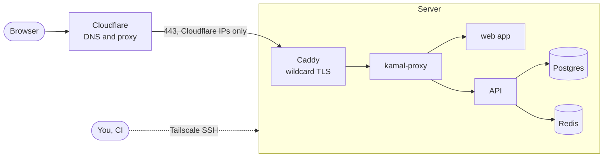
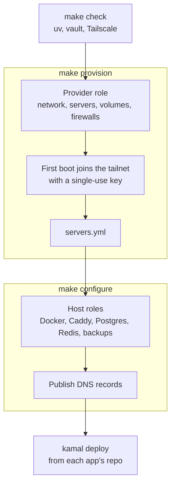
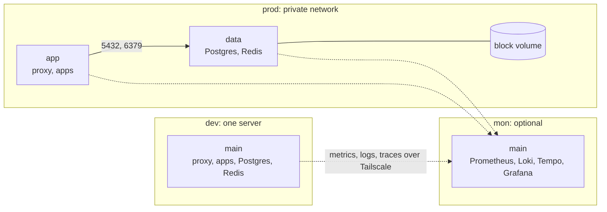

# Shipyard

Shipyard is a template for running containerised apps on your own servers, on the cloud you choose. Copy it, fill in one vars file and an encrypted vault, and run `make up`. You get servers with TLS on every subdomain, Postgres and Redis, nightly backups, and no public SSH port. Then deploy your apps to them with [Kamal](https://kamal-deploy.org).

## Why it exists

A PaaS is quick to start with, but you give up private networking, your own database, predictable cost and the option to leave. Kubernetes gives all of that back, and asks for far more than a small team wants to run. The middle ground is a few servers wired together well: Ansible to build them, Kamal to deploy, Caddy for TLS, Cloudflare in front, and Tailscale as the only way in.

The tools all exist, but wiring them together correctly takes weeks, and some mistakes only show up in production. Shipyard is that wiring. It comes from infrastructure that has run real dev and prod environments, and the lessons are written into the roles and the guide.

## What you get

- **Servers on your cloud.** A provider creates the private network, servers, volumes and firewalls. DigitalOcean is built in, and `byo` configures machines you already have, on any host. The rest of Shipyard never calls a cloud API, so adding a cloud means writing one role.
- **No public SSH.** Servers join your Tailscale tailnet at first boot. Ansible, Kamal and CI connect over Tailscale SSH, and port 22 stays closed to the internet. Tags are scoped per project and environment, so a dev deploy can never reach prod.
- **Cloudflare-only web traffic.** In a `public` environment, ports 80 and 443 accept connections from Cloudflare's IP ranges only. In a `private` environment, nothing is public, and apps are reachable from the tailnet.
- **TLS for every subdomain.** Caddy gets a wildcard certificate per environment through Cloudflare DNS-01 and forwards to kamal-proxy, so apps deploy without handling certificates.
- **Postgres and Redis.** They run on the data server, managed by Ansible, not Kamal. In prod their data sits on a block volume that survives a server rebuild. Changing a password in the vault changes it in the running service.
- **Backups.** Nightly `pg_dump` to Cloudflare R2, with retention, a restore script and a documented restore drill.
- **Optional modules.** A Cloudflare Tunnel for webhooks into a private environment, a managed load balancer, and an observability stack with Prometheus, Loki, Tempo and Grafana.
- **Repeatable runs.** A second `make up` changes nothing, and `make verify` checks the security promises from outside and inside.

## How a request reaches your app



The server's firewall drops everything else, including port 22. You, Ansible, Kamal and CI reach it only over Tailscale.

## What `make up` does



`servers.yml` is the contract between the two halves. Configure reads only that file, so it works the same on every provider, and it publishes DNS last, so a record never points at a server that isn't ready.

## Environments



Each environment has its own inventory, vault, Tailscale tags and Cloudflare zone. dev and prod can run on different providers.

## Secrets

| Kind | Where it lives | Read by |
|---|---|---|
| Infrastructure: provider, Cloudflare, Tailscale and R2 tokens, database passwords | An Ansible Vault per environment, committed encrypted | Ansible |
| App: connection strings, API keys | Doppler, one project per app and one config per environment | Kamal, at deploy time |

## Quick start

You need [uv](https://docs.astral.sh/uv/), Tailscale on your machine, a domain on Cloudflare, and an account with a supported provider.

```bash
make install
# edit ansible/inventories/dev/group_vars/all/vars.yml
make vault-init ENV=dev
make up ENV=dev
make verify ENV=dev
```

The [guide](docs/guide.md) walks through every account, token and step, and gives the reason for each choice.

## Repository layout

| Path | What's there |
|---|---|
| `ansible/roles/` | Providers (`provision_digitalocean`, `provision_byo`), host roles (`common`, `docker`, `caddy`, `data`, `dns`, `backups`) and modules (`tunnel`, `load_balancer`, `observability`, `monitoring`). |
| `ansible/inventories/` | The `dev`, `prod` and `mon` environments, each with a `vars.yml` and a `vault.yml.example`. |
| `ansible/playbooks/` | `provision`, `configure`, `site`, `verify`, `diag` and `destroy`. |
| `examples/` | Kamal configs for a web app and an API, and a deploy workflow. |
| `docs/` | The guide, provider pages, module pages and runbooks. |
| `.github/workflows/` | Lint on every push, and a manual provisioning workflow per environment. |

## What it isn't

- Not Kubernetes. There's no autoscaling and no multi-region.
- Not a managed database. Postgres runs on your server, and point-in-time recovery isn't included.
- Not a dependency. You copy the template once and own the copy. There's no upstream to track.

## Licence

[MIT](LICENSE)
