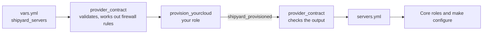

# Writing a provider

A provider is one role, `ansible/roles/provision_<name>/`. Core roles never call a cloud API, so a provider that meets this contract works with every other part of Shipyard.



## What the provider receives

`provider_contract` validates the environment and then includes `provision_<name>` with these facts set:

| Fact | Contents |
|---|---|
| `shipyard_servers_valid` | The server list, validated, with `roles` sorted and `volume_gb` defaulted to null. |
| `shipyard_firewall_by_server` | For each hostname, its inbound rules as `{protocol, ports, sources}`. |
| `shipyard_project`, `shipyard_env`, `shipyard_region`, `shipyard_network_cidr` | From the environment's vars. |

Hostnames come from `item.name | shipyard_hostname(shipyard_project, shipyard_env)`.

## What the provider must do

1. Put every server on one private network using `shipyard_network_cidr`.
2. Create each missing server. Leave existing ones alone.
3. Mint Tailscale keys only for servers it's about to create, by including `tailscale_key` with `tailscale_key_hostnames`. Keys land in `shipyard_tailscale_keys[hostname]`.
4. Boot each new server with `roles/provider_contract/templates/cloud-init.sh.j2` as user data, rendered with `hostname` and `tailscale_key`.
5. Install no provider SSH key, and never open port 22 to the internet.
6. Create a block volume and attach it for each server with `volume_gb`.
7. Apply each server's rules from `shipyard_firewall_by_server`. A second run with the same rules changes nothing. A run with changed rules converges to them.
8. Set `shipyard_provisioned` to one entry per server:

   ```yaml
   - name: main                         # the short name
     hostname: example-dev-main
     private_ip: 10.10.0.2
     public_ip: 203.0.113.10            # or null
     volume_device: /dev/disk/by-id/... # a stable path, or null
   ```

9. Provide `tasks/destroy.yml`, which deletes the environment's servers and firewalls, and deletes volumes only when `destroy_volumes` is true.

## Capabilities

`meta/shipyard.yml` lists optional features the provider supports:

```yaml
capabilities: []
```

## When it's ready

A provider is ready when a throwaway dev environment comes up from the guide, a second `make up` reports `changed=0`, `make verify` passes, the example app serves on its subdomain, and `make destroy` removes everything.
